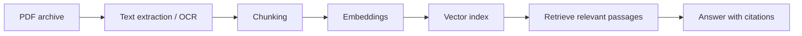
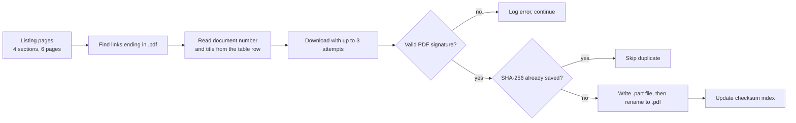

<div align="center">

# 🇺🇸 JCS Military Documentation Archive

### Preserving Military Knowledge. Supporting Research. Building Better AI.


**Official source:** https://www.jcs.mil/ &nbsp;•&nbsp; **Repository:** https://github.com/PrajwalKoirala638/jcs-mil-documentation

</div>

The **JCS Military Documentation Archive** is an open collection of publicly available United States Joint Chiefs of Staff (JCS) publications, together with the tools used to collect and manage them. It aims to make these documents easier to discover, study, reference, and use in research, and to give developers and AI researchers authentic source material for building more knowledgeable, accurate, and context-aware systems.

---

## 📑 Table of Contents

1. [At a Glance](#at-a-glance)
2. [Project Mission](#mission)
3. [What Is in the Archive](#archive)
4. [Why These Documents Are Useful](#useful)
5. [Benefits for AI and Machine Learning](#ai)
6. [Benefits for Researchers, Students, and the Public](#audiences)
7. [Repository Structure](#structure)
8. [Quick Start: Install and Run](#quick-start)
9. [How the Scraper Works](#how-it-works)
10. [Configuration Reference](#configuration)
11. [Output, Filenames, and Logging](#output)
12. [Inspecting Your Collection](#inspect)
13. [PDF Compression and Git Sync (`upload.sh`)](#upload)
14. [Code Quality and Testing](#quality)
15. [Troubleshooting](#troubleshooting)
16. [FAQ](#faq)
17. [Ideas for the Future](#roadmap)
18. [Important Notice, Copyright & Responsible Use](#notice)
19. [Contributing](#contributing)
20. [Support the Project](#support)

---

<a id="at-a-glance"></a>

## 🔎 At a Glance

| Item                   | Details                                                                             |
| ---------------------- | ----------------------------------------------------------------------------------- |
| **What it is**         | An archive of public JCS directive PDFs plus the scripts that collect and sync them |
| **Official source**    | The CJCS Directives Library at [jcs.mil/Library](https://www.jcs.mil/Library)       |
| **Sections collected** | CJCS Instructions, Manuals, Notices, and Guides                                     |
| **Listing pages read** | 6 (Instructions: 3 pages; Manuals, Notices, Guides: 1 page each)                    |
| **File format**        | PDF                                                                                 |
| **Collector**          | `jcs_pdf_scraper.py`, an asynchronous Playwright (Chromium) scraper                 |
| **Duplicate handling** | SHA-256 checksum of every file, plus URL tracking within a run                      |
| **Failure handling**   | Up to 3 attempts per PDF with growing delays; one bad link never stops the run      |
| **Logging**            | Every step is printed to the console at `DEBUG` level                               |
| **Python**             | 3.9 or newer                                                                        |

---

<a id="mission"></a>

## 🎯 Project Mission

Military documentation holds decades of institutional knowledge, operational terminology, historical information, organizational guidance, and professional reference material. Unfortunately, important publications can be difficult to discover, access, organize, and analyze across different sources.

This project helps address that problem by bringing publicly available PDF documentation into an organized, accessible research archive.

| Goal                 | What it means                                                                       |
| -------------------- | ----------------------------------------------------------------------------------- |
| 📚 **Preserve**      | Keep publicly available military documentation available for long-term reference    |
| 🔎 **Discover**      | Make publications easier to find and study                                          |
| 🤖 **Enable AI**     | Give AI researchers reliable reference material for retrieval and evaluation        |
| 🧠 **Teach context** | Help AI systems understand military terminology, structures, and historical context |
| 🎓 **Educate**       | Support students, researchers, historians, and military enthusiasts                 |
| 💻 **Experiment**    | Give developers and ML engineers real source material to work with                  |
| 🇺🇸 **Remember**      | Help preserve publicly available U.S. military knowledge for future generations     |

---

<a id="archive"></a>

## 🗂️ What Is in the Archive

The Joint Staff publishes policy and procedural material as **directives**. The public library at [jcs.mil/Library](https://www.jcs.mil/Library) hosts the unclassified, unrestricted ones, and this project collects four kinds of them:

| Type             | Typical prefix | Purpose                                                                                      | Section collected                                                               | Pages read |
| ---------------- | -------------- | -------------------------------------------------------------------------------------------- | ------------------------------------------------------------------------------- | :--------: |
| **Instructions** | `CJCSI`        | Publish Chairman and Joint Staff policy, internal and external                               | [`/Library/CJCS-Instructions/`](https://www.jcs.mil/Library/CJCS-Instructions/) |     3      |
| **Manuals**      | `CJCSM`        | Detailed procedures and informational material; may supplement an instruction or stand alone | [`/Library/CJCS-Manuals/`](https://www.jcs.mil/Library/CJCS-Manuals/)           |     1      |
| **Notices**      | `CJCSN`        | Short-term policy; each notice carries a specific expiration date                            | [`/Library/CJCS-Notices/`](https://www.jcs.mil/Library/CJCS-Notices/)           |     1      |
| **Guides**       | `CJCSG`        | Detailed information and guidance from the Chairman on a specific topic                      | [`/Library/CJCS-Guides/`](https://www.jcs.mil/Library/CJCS-Guides/)             |     1      |

### Reading a document number

A number such as `CJCSI 3520.02C` is built from a **type prefix** (`CJCSI` = Chairman of the Joint Chiefs of Staff Instruction), a **subject series** (`3520.02`), and usually a **trailing letter** that marks the revision. A later letter generally supersedes an earlier one, so `5701.01D` replaces `5701.01C`.

### What is _not_ collected

| Not collected                                                              | Why                                                  |
| -------------------------------------------------------------------------- | ---------------------------------------------------- |
| Controlled-access (.mil / .gov only) directives                            | Not released to the public                           |
| Classified or restricted material                                          | Never part of this project                           |
| Joint Staff (JS) and directorate directives that are not publicly released | Outside the public library                           |
| Joint publications (joint doctrine)                                        | Published separately from these four directive types |

Each document should still be evaluated individually for its subject, publication date, authority, and intended audience. Directives are revised, superseded, and canceled over time, so always confirm the current version at the official source.

---

<a id="useful"></a>

## 📖 Why These Documents Are Useful

Depending on the publication, the PDFs may contain:

| Theme        | Examples of content                                                 |
| ------------ | ------------------------------------------------------------------- |
| Policy       | Official Chairman and Joint Staff policy and institutional guidance |
| Procedures   | Joint procedures, processes, and responsibilities                   |
| Terminology  | Military terminology, definitions, and abbreviations                |
| Organization | Organizational structures and roles                                 |
| Planning     | Strategic planning guidance and joint concepts                      |
| History      | Earlier versions that show how policy and terminology changed       |
| Education    | Reference material for professional military education              |

---

<a id="ai"></a>

## 🤖 Benefits for Artificial Intelligence & Machine Learning

A primary long-term goal is to make authentic military reference material more accessible to AI researchers and developers. High-quality source documentation helps build systems that understand a specialized domain instead of relying only on general-purpose internet text.

### 1. Better military knowledge

Military publications contain specialized vocabulary, definitions, and explanations. They can help AI systems:

- Understand military-specific language.
- Recognize relationships between military concepts.
- Interpret official terminology more accurately.
- Answer research questions using documented sources.
- Tell specialized terminology apart from everyday language.

### 2. Retrieval-Augmented Generation (RAG)

PDFs can be turned into a searchable knowledge base so an application retrieves relevant passages _before_ generating an answer.



| Stage    | What happens                                               | Typical tools                   |
| -------- | ---------------------------------------------------------- | ------------------------------- |
| Extract  | Read text from each PDF; OCR scanned pages                 | `pdftotext`, PyMuPDF, Tesseract |
| Chunk    | Split text into passages that keep headings and numbering  | Custom splitters                |
| Embed    | Turn passages into vectors                                 | Any embedding model             |
| Index    | Store vectors with source metadata (document number, page) | FAISS, SQLite, vector databases |
| Retrieve | Find the passages closest to a question                    | Similarity search               |
| Answer   | Generate a response that cites the retrieved passages      | Any language model              |

Potential applications include military documentation search engines, AI research assistants, publication discovery tools, document question answering, source-backed knowledge retrieval, and historical or institutional research assistants.

### 3. Better AI training and evaluation

Where licensing, copyright, security restrictions, and other permissions allow, researchers may investigate extracted content for:

| Use                            | Example                                               |
| ------------------------------ | ----------------------------------------------------- |
| Domain-specific model training | Adapting a model to joint-staff terminology           |
| Fine-tuning datasets           | Supervised instruction/response pairs                 |
| Information retrieval          | Ranking experiments on directive text                 |
| Semantic search                | Evaluating embedding quality on military vocabulary   |
| Classification                 | Sorting documents by type, series, or topic           |
| Named entity recognition       | Organizations, commands, and document references      |
| Question-and-answer sets       | Source-grounded evaluation questions                  |
| Benchmarking                   | Testing how well a model handles specialist documents |

> **Important:** Access to a publicly available PDF does not automatically grant permission to use its contents for model training or redistribution. Verify the rights and restrictions for each publication.

### 4. Improved accuracy and context

General-purpose AI systems may lack the context needed to interpret military publications correctly. Using authoritative reference material in retrieval and evaluation workflows can help:

- Reduce unsupported answers.
- Improve terminology consistency.
- Provide traceable references.
- Preserve the context of official publications.
- Encourage evidence-based responses.

AI-generated answers should still be independently verified against the original publications.

---

<a id="audiences"></a>

## 🔬 Benefits for Researchers, Students, and the Public

### Researchers and developers

| Area                        | Potential benefit                                  |
| --------------------------- | -------------------------------------------------- |
| AI research                 | Domain-specific knowledge retrieval and evaluation |
| Machine learning            | Document classification and NLP experiments        |
| Data science                | Structured extraction and document analysis        |
| Education                   | Military history and institutional research        |
| Software development        | Search engines and document-processing tools       |
| Digital preservation        | Long-term organization of public references        |
| Natural language processing | Terminology extraction and semantic analysis       |

### Students, historians, and the public

| Audience                                 | What they can do                                                                                                                           |
| ---------------------------------------- | ------------------------------------------------------------------------------------------------------------------------------------------ |
| 🎓 **Students**                          | Use reference material for academic research; study terminology and institutional concepts; explore primary-source documentation           |
| 🏛️ **Historians**                        | Examine official publications as historical sources; compare documents across publication dates; trace changes in doctrine and terminology |
| 🎖️ **Veterans and military communities** | Discover publicly available publications and historical or institutional reference material                                                |
| 🔍 **Independent researchers**           | Build searchable personal research collections and cite original sources                                                                   |

This archive is an informational resource, not an official military service or a replacement for government benefits offices, veterans' representatives, or legal advice.

---

<a id="structure"></a>

## 📂 Repository Structure

```text
jcs-mil-documentation/
│
├── README.md               # This file
├── LICENSE                 # License terms
├── requirements.txt        # Python dependencies (Playwright)
├── ruff.toml               # Linter settings used during development
├── jcs_pdf_scraper.py      # Asynchronous scraper that downloads the PDFs
├── upload.sh               # Compresses PDFs and syncs them with Git
│
├── PDFs/                   # Created by the scraper; downloaded PDFs land here
└── documents/              # Intended long-term location for the curated archive
```

The scraper writes to `PDFs/` by default. Move or sync files into `documents/` (for example with `upload.sh`) as you curate the archive.

---

<a id="quick-start"></a>

## ⚙️ Quick Start: Install and Run

### Requirements

| Requirement      | Notes                                                                           |
| ---------------- | ------------------------------------------------------------------------------- |
| Operating system | Commands below target Debian/Ubuntu; other systems need the equivalent packages |
| Python           | 3.9 or newer                                                                    |
| Browser          | Chromium, installed through Playwright                                          |
| Disk space       | Enough for the PDFs plus Playwright's browser download                          |
| Network          | Access to `www.jcs.mil`                                                         |

### Install and run

```bash
# Install required applications
sudo apt-get install bash git ghostscript coreutils util-linux findutils grep sed gawk psmisc openssh-client ca-certificates python3 python3-pip python3-venv python3-lxml python3-psutil iputils-ping xvfb nodejs -y

# Clone the repository
git clone --depth 1 https://github.com/PrajwalKoirala638/jcs-mil-documentation

# Enter the folder
cd jcs-mil-documentation

# Create a virtual environment
python3 -m venv .venv

# Activate the virtual environment
source .venv/bin/activate

# Install the Python packages required by the project.
pip install -r requirements.txt

# Install the required Python packages
pip install playwright

# Install Playwright system dependencies
playwright install --with-deps

# Install Playwright Chromium
playwright install chromium

# Install Playwright Firefox (optional: the scraper itself uses Chromium)
playwright install firefox

# Run the script
python3 jcs_pdf_scraper.py
```

The script takes **no command-line arguments**. It opens a visible Chromium window, scrapes the six listing pages, downloads every new PDF into `PDFs/`, prints a summary, and **closes the browser automatically** when it is finished.

### Running on a server without a display

The scraper opens a visible browser by default, which needs a display. On a headless server, either run it under a virtual display (`xvfb` is already in the install command):

```bash
xvfb-run -a python3 jcs_pdf_scraper.py
```

or set `run_browser_headless` to `True` in `ScraperConfiguration` (see [Configuration Reference](#configuration)).

---

<a id="how-it-works"></a>

## 🛠️ How the Scraper Works



1. **Index what you already have.** Every PDF already in `PDFs/` is hashed with SHA-256, so re-running never saves the same content twice.
2. **Open each listing page.** Chromium loads the page and waits briefly for client-side content to render.
3. **Find PDF links.** Every link whose address ends in `.pdf` is kept. Spaces and special characters in addresses are percent-encoded so the download request is valid.
4. **Read metadata.** The document number and title come from the first two cells of the link's table row. If a row is missing, safe fallbacks are used.
5. **Download with retries.** Network and HTTP errors are retried up to three times with growing delays. A response that is not a PDF is rejected immediately, because retrying would not help.
6. **Deduplicate.** A PDF is skipped if its URL was already handled in this run, or if its checksum matches a file already saved.
7. **Save safely.** New files are written to a temporary `.part` file and then renamed, so an interrupted run never leaves a half-written `.pdf`.
8. **Report.** A summary of downloaded, skipped, and failed items is logged, and the browser is closed.

---

<a id="configuration"></a>

## 🎛️ Configuration Reference

All settings live in the `ScraperConfiguration` class near the top of `jcs_pdf_scraper.py`. The listing pages themselves are defined by `LISTING_SECTIONS`, which pairs each section address with its number of pages.

| Setting                                            | Default         | Meaning                                                 |
| -------------------------------------------------- | --------------- | ------------------------------------------------------- |
| `download_folder_path`                             | `PDFs`          | Folder that receives the downloaded PDFs                |
| `listing_page_urls`                                | 6 pages         | Listing pages to scrape (built from `LISTING_SECTIONS`) |
| `run_browser_headless`                             | `False`         | `True` hides the browser window                         |
| `maximum_download_attempts`                        | `3`             | Tries per PDF before giving up                          |
| `retry_backoff_seconds`                            | `2.0`           | Base delay; multiplied by the attempt number            |
| `page_load_timeout_milliseconds`                   | `60000`         | Maximum wait for a listing page                         |
| `listing_render_delay_milliseconds`                | `3000`          | Extra wait for client-side content                      |
| `download_timeout_milliseconds`                    | `60000`         | Maximum wait for one PDF                                |
| `slow_motion_milliseconds`                         | `500`           | Pause between browser actions (easier to watch)         |
| `viewport_width_pixels` / `viewport_height_pixels` | `1440` / `1000` | Browser window size                                     |

### Sources scraped

| Section      | Address                                                                         | Pages |
| ------------ | ------------------------------------------------------------------------------- | :---: |
| Instructions | `https://www.jcs.mil/Library/CJCS-Instructions/?udt_46626_param_page=1` to `=3` |   3   |
| Manuals      | `https://www.jcs.mil/Library/CJCS-Manuals/`                                     |   1   |
| Notices      | `https://www.jcs.mil/Library/CJCS-Notices/`                                     |   1   |
| Guides       | `https://www.jcs.mil/Library/CJCS-Guides/`                                      |   1   |

---

<a id="output"></a>

## 📦 Output, Filenames, and Logging

### Filenames

Each file is named from its document number, its title, and a short hash of its source address:

```text
<document number>_<title>_<8-character URL hash>.pdf
```

| Rule       | Detail                                                                                                 |
| ---------- | ------------------------------------------------------------------------------------------------------ |
| Case       | Everything is lowercased                                                                               |
| Characters | Every run of characters other than `a-z` and `0-9` becomes one underscore                              |
| Length     | The readable part is capped at 120 characters                                                          |
| Uniqueness | The URL hash keeps similarly titled documents apart; if a name still collides, a content hash is added |
| Example    | `CJCSI 1001.01` + `First & Test!` becomes `cjcsi_1001_01_first_test_ec7becdb.pdf`                      |

### Console log

Every step is printed at `DEBUG` level with a timestamp, the function name, and the line number. Messages carry a tag so they are easy to filter:

| Tag             | Meaning                                                        |
| --------------- | -------------------------------------------------------------- |
| `[PAGE]`        | A listing page is being opened or finished                     |
| `[FOUND]`       | A PDF link was discovered, with its number, title, and address |
| `[DOWNLOAD]`    | A request was sent or a response received                      |
| `[SAVED]`       | A new PDF was written to disk                                  |
| `[SKIP]`        | A duplicate (by address or by content) was skipped             |
| `[RETRY]`       | An attempt failed and another will follow                      |
| `[ERROR]`       | A download or page failed after all attempts                   |
| `[BROWSER ...]` | Browser requests, responses, console messages, and page errors |
| `[SUMMARY]`     | Final totals                                                   |

The run ends with a summary such as:

```text
[SUMMARY] Scraping completed.
[SUMMARY] Newly downloaded PDFs: <count>
[SUMMARY] Duplicate PDFs skipped: <count>
[SUMMARY] Errors: <count>
[SUMMARY] Download directory: /path/to/PDFs
```

### Exit codes

| Code  | Meaning                                                                  |
| ----- | ------------------------------------------------------------------------ |
| `0`   | The run finished (individual PDFs may still have failed; check `Errors`) |
| `1`   | Setup problem, for example Chromium could not start                      |
| `130` | Interrupted with Ctrl+C                                                  |

---

<a id="inspect"></a>

## 📊 Inspecting Your Collection

Handy commands for checking what you have collected:

```bash
# How many PDFs, and how much disk space they use
ls PDFs/*.pdf | wc -l
du -sh PDFs

# Count by directive type (filenames start with the lowercased document number)
for prefix in cjcsi cjcsm cjcsn cjcsg; do
  printf '%s: ' "$prefix"; ls PDFs | grep -c "^${prefix}_"
done

# The ten largest files
ls -S PDFs/*.pdf | head -n 10

# Verify that no two files have identical content
sha256sum PDFs/*.pdf | sort | uniq -w64 -d

# Find files that are not valid PDFs
for file in PDFs/*.pdf; do head -c 5 "$file" | grep -q '%PDF-' || echo "Not a PDF: $file"; done
```

---

<a id="upload"></a>

## 🔄 PDF Compression and Git Sync (`upload.sh`)

This repository also includes an automated synchronization utility. The `upload.sh` script is designed to:

| Capability       | Detail                                                                   |
| ---------------- | ------------------------------------------------------------------------ |
| 👀 **Watch**     | Monitor a repository for newly downloaded or modified PDFs               |
| 🗜️ **Compress**  | Shrink eligible PDFs using Ghostscript                                   |
| ⏳ **Stay safe** | Avoid processing incomplete downloads                                    |
| 📥 **Stage**     | Stage successfully compressed documents                                  |
| 🔁 **Sync**      | Commit and synchronize document batches with Git                         |
| 🌐 **Retry**     | Retry temporary network failures                                         |
| 💽 **Monitor**   | Watch disk space and processing activity                                 |
| ⚙️ **Configure** | Provide configurable limits for file sizes and synchronization intervals |

The script reads its settings from environment variables, so behavior can be adjusted without editing the source. See `upload.sh` for implementation details and the available settings.

---

<a id="quality"></a>

## ✅ Code Quality and Testing

The scraper is written to be readable and checkable.

| Practice            | Detail                                                                                                                                                                                                  |
| ------------------- | ------------------------------------------------------------------------------------------------------------------------------------------------------------------------------------------------------- |
| **Comments**        | Every line of `jcs_pdf_scraper.py` has an explanatory comment                                                                                                                                           |
| **Naming**          | Functions and variables use full, descriptive names                                                                                                                                                     |
| **Structure**       | A scraper class, a configuration dataclass, small typed helpers, and custom error types                                                                                                                 |
| **Static checks**   | Passes `pyflakes`, `mypy --strict`, `pylint` (10.00/10), `bandit`, and `ruff` (with the included `ruff.toml`)                                                                                           |
| **End-to-end test** | Exercised in headless Chromium against a local test server: new PDFs saved, duplicate content and repeated links skipped, fake PDFs and missing files logged as errors, a second run downloaded nothing |

Run the checks yourself:

```bash
pip install ruff pyflakes pylint mypy bandit
ruff check jcs_pdf_scraper.py
python3 -m pyflakes jcs_pdf_scraper.py
mypy --strict jcs_pdf_scraper.py
pylint --disable=line-too-long jcs_pdf_scraper.py
bandit -q jcs_pdf_scraper.py
```

Two deliberate exceptions are documented in the code and in `ruff.toml`: one `global` statement (guards against adding duplicate log handlers) and one `assert` (an internal sanity check after a file is saved).

---

<a id="troubleshooting"></a>

## 🧰 Troubleshooting

| Symptom                                 | Likely cause                                                     | Fix                                                                                  |
| --------------------------------------- | ---------------------------------------------------------------- | ------------------------------------------------------------------------------------ |
| `Chromium could not start`              | Chromium is not installed                                        | Run `python -m playwright install chromium`                                          |
| Chromium fails to start on a server     | No display is available                                          | Use `xvfb-run -a python3 jcs_pdf_scraper.py` or set `run_browser_headless` to `True` |
| Missing system libraries when launching | Browser dependencies are not installed                           | Run `playwright install --with-deps`                                                 |
| `Errors` count is not zero              | Bad links, timeouts, or non-PDF responses                        | Search the log for `[ERROR]` and `[RETRY]` lines to see each cause                   |
| Many duplicates skipped                 | Content already saved, or the same link appears on several pages | Expected behavior; nothing is saved twice                                            |
| Syntax error on startup                 | Python older than 3.9                                            | Check with `python3 --version` and upgrade                                           |
| `ModuleNotFoundError: playwright`       | Virtual environment not active                                   | Run `source .venv/bin/activate`, then `pip install -r requirements.txt`              |
| Nothing is found on a page              | The site layout changed                                          | Inspect the listing page; the scraper expects PDF links inside table rows            |

---

<a id="faq"></a>

## ❓ FAQ

**Does it re-download files I already have?**
It still requests each PDF, but it compares the SHA-256 checksum with your saved files and skips anything identical, so nothing is stored twice.

**Can I stop it and start again?**
Yes. Files are written atomically, and the next run indexes what already exists. Pressing Ctrl+C ends the run cleanly with exit code `130`.

**Why does a browser window open?**
The default is a visible browser so the run is easy to watch. Set `run_browser_headless` to `True`, or use `xvfb-run`, to hide it.

**Does the scraper download classified or restricted documents?**
No. It only reads the public listing pages, which host unclassified, unrestricted directives. Controlled-access directives are not part of the public library.

**Are these documents current?**
Not necessarily. Directives are revised, superseded, and canceled. Always confirm the current version at [jcs.mil](https://www.jcs.mil/).

**Can I use the PDFs to train a model?**
That depends on each publication's rights and restrictions. See the notice below, and verify before using any content for training or redistribution.

---

<a id="roadmap"></a>

## 🧭 Ideas for the Future

These are ideas, not commitments:

- [ ] Save a metadata file (document number, title, source address, checksum, download date) alongside the PDFs.
- [ ] Extract text and build a searchable index of the whole archive.
- [ ] Track which directives were revised, superseded, or canceled between runs.
- [ ] Add a changelog that lists newly downloaded documents for each run.
- [ ] Provide a ready-to-use RAG example over the archive.
- [ ] Add automated tests that run on every contribution.

---

<a id="notice"></a>

## ⚠️ Important Notice, Copyright & Responsible Use

This is an independent, community-oriented documentation project.

- This repository is not affiliated with, endorsed by, or officially operated by the United States Department of Defense or the Joint Chiefs of Staff.
- Original publications remain subject to their respective copyright, licensing, distribution, and usage restrictions.
- Public accessibility does not automatically mean unrestricted redistribution or commercial AI training is permitted.
- Users should consult the original source and applicable publication markings before relying on or redistributing a document.
- Do not upload classified, controlled, export-restricted, sensitive, or otherwise unauthorized material.
- Do not use this collection as a substitute for official military instructions or current operational guidance.
- Be considerate to the source website: the scraper is designed to be gentle (a small number of pages, delays between actions, limited retries), so please do not modify it to hammer the server.

Official source: https://www.jcs.mil/

---

<a id="contributing"></a>

## 🤝 Contributing

Contributions that improve the archive are welcome.

| Area          | Ideas                                         |
| ------------- | --------------------------------------------- |
| Organization  | Improve how documents are organized and named |
| Accuracy      | Report broken or outdated references          |
| Documentation | Add notes about individual publications       |
| Processing    | Improve PDF processing and compression        |
| Search        | Develop searchable document indexes           |
| AI tools      | Build responsible AI research tools           |
| Metadata      | Improve metadata and document discoverability |

**Before you open a pull request:**

1. Run the checks listed under [Code Quality and Testing](#quality).
2. Keep the code style: descriptive names and a comment on every line.
3. Make sure any contributed material is publicly shareable and that you have the necessary rights to distribute it.

---

<a id="support"></a>

## ⭐ Support the Project

If you find this project useful:

- ⭐ Star the repository.
- 🍴 Fork it for research and development.
- 📢 Share it with researchers and developers.
- 💻 Contribute improvements.
- 📚 Help make public documentation easier to discover.

Repository: https://github.com/PrajwalKoirala638/jcs-mil-documentation

---

<div align="center">

### 🇺🇸 Preserving Knowledge for the Future

The goal is bigger than simply collecting PDF files. It is about preserving valuable public documentation, making institutional knowledge easier to access, supporting responsible research, and helping developers build AI systems that can understand specialized information with greater accuracy and context.

**Better documentation. Better research. Better AI.**

</div>
